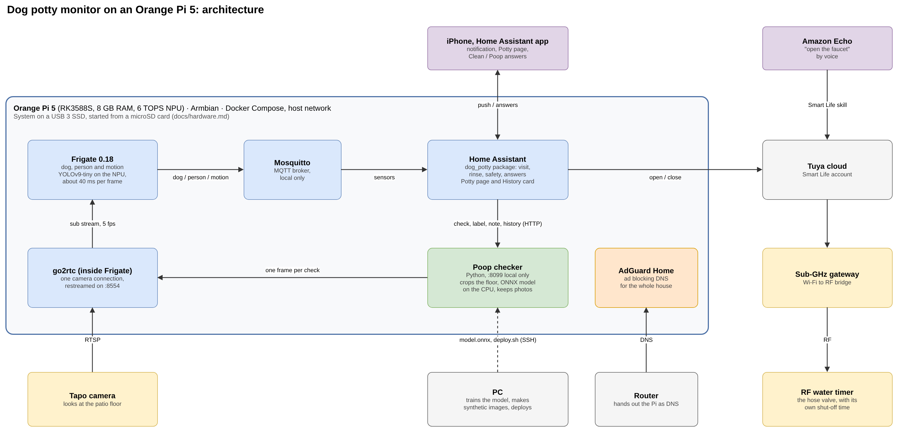
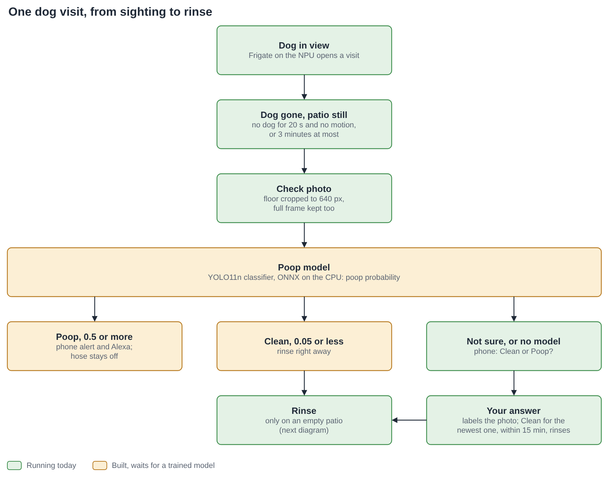
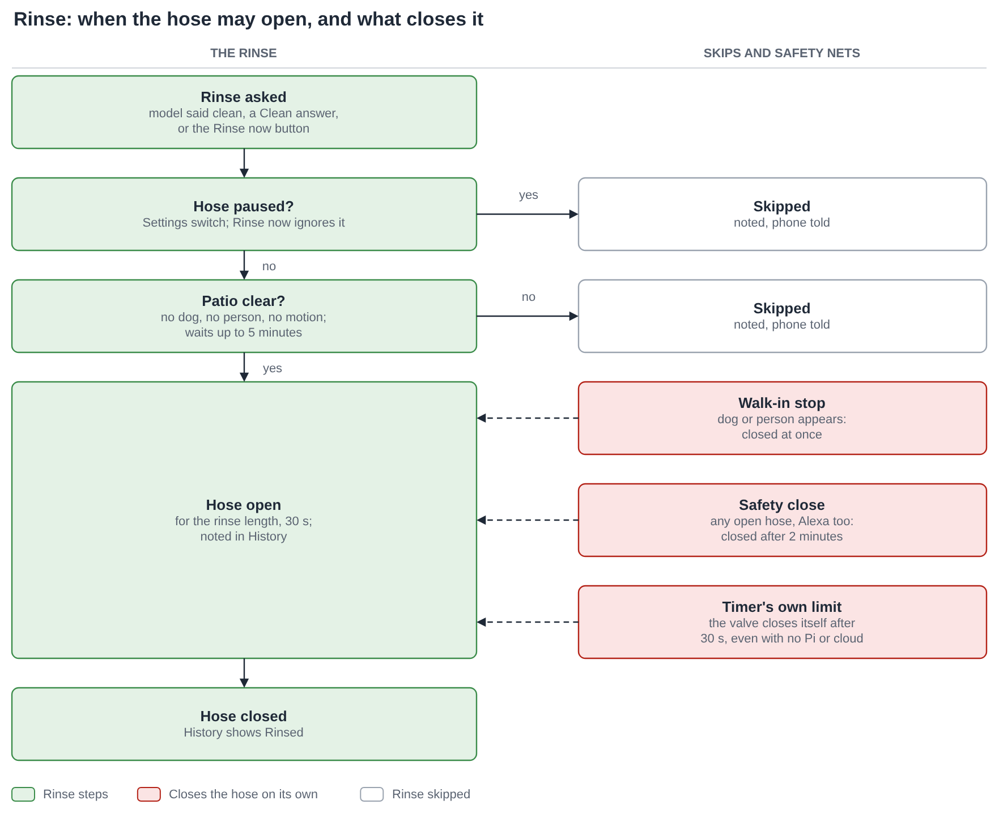
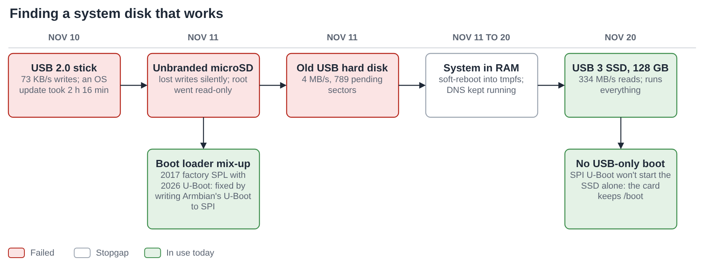

# Dog potty monitor on an Orange Pi 5

A camera watches the patio where the dog does its business. After each visit,
an Orange Pi 5 photographs the floor and decides whether there is poop:

- **Clean floor:** a garden hose valve rinses the spot for 30 seconds, but only when
  no dog, no person and nothing else moves in view.
- **Poop:** the hose stays off and the phone gets an alert, so someone picks it up first.
- **Not sure:** the phone asks "Clean or Poop?". Every answer becomes a labeled training photo
  for the small model that will make the call on its own.

Everything runs locally on the Pi, in Docker: [Frigate](https://frigate.video) detects
the dog on the board's NPU, [Home Assistant](https://www.home-assistant.io) runs the flow,
and a small Python service takes and classifies the photos. The same Pi blocks ads for
the house with AdGuard Home. Camera photos never leave the Pi.



## How a visit goes



1. Frigate sees a dog anywhere in the camera view and Home Assistant opens a visit.
2. The dog leaves. The photo waits until there has been no dog for 20 s **and** no motion,
   because Frigate sometimes loses a dog that is right in front of the lens. If something
   keeps moving (rain, insects at the night lights), the photo is taken anyway after 3 minutes.
3. The poop checker grabs one frame, crops the floor to 640x640 and runs the classifier.
4. The verdict picks the branch. Until a model is trained, every visit takes the
   "not sure" branch and asks on the phone.

The rinse has its own guards, because a wrong rinse sprays poop across the floor or
soaks someone on the patio:



More in [docs/pipelines.md](docs/pipelines.md), including the training-data loop.

## Status

| Part | State |
| --- | --- |
| Dog, person and motion detection on the NPU | Running |
| Check photo, phone question, labels | Running |
| Rinse with the safety guards | Running; rinses after a "Clean" answer |
| Potty page in the Home Assistant app: photo, history, settings | Running |
| Ad blocking for the house | Running |
| Poop classifier | Not trained yet: 3 poop photos of the 20 that `train.py` asks for |
| Synthetic training images | Generator built and tested with local cut-outs only |
| Alexa announcements | Not set up. Alexa can already open the hose by voice through the Smart Life skill |
| IP KVM (One-KVM, in the compose file) | Not set up |

## Hardware

| Part | Used here | Notes |
| --- | --- | --- |
| Board | Orange Pi 5, RK3588S, 8 GB | Uses 1.8 GB of RAM. The 6 TOPS NPU runs the dog detector |
| System disk | 128 GB USB 3 SSD | Started from a microSD card that holds `/boot` |
| Camera | TP-Link Tapo, RTSP | Any RTSP camera works |
| Hose | Tuya RF water timer and Sub-GHz gateway | Has its own shut-off time, the last safety net |
| Phone | iPhone with the Home Assistant app | Notifications, answers, Potty page |
| PC | Any | Trains the model, makes synthetic images, deploys |

[docs/hardware.md](docs/hardware.md) has the requirements (RAM, NPU instead of a GPU, storage),
measured numbers, and what it took to get a system disk that works:



## Repository

```
stack/                     the folder that runs on the Pi
  docker-compose.yml       Frigate, Home Assistant, Mosquitto, AdGuard Home, poop checker
  .env.example             camera address and account, floor crop, timezone
  setup.sh                 creates folders and starter files on the Pi
  deploy.sh                copies changes from a PC to the Pi, checks, restarts what changed
  frigate/config/          Frigate: NPU detector, camera, motion settings
  homeassistant/
    packages/dog_potty.yaml       the whole flow: sensors, scripts, automations
    dashboards/potty.yaml         Potty page: Photo, History and Settings tabs
    www/potty-history-card.js     History card with a full-screen photo viewer
  poop-checker/            Python service: photo, crop, ONNX classifier, labels, history
  training/train.py        trains the classifier on a PC and exports model.onnx
tools/
  synth/                   synthetic training images (poop and decoys on real floor frames)
  host/                    Pi helpers: Docker install, AdGuard tuning, disk checks, missed-visit report
docs/                      hardware, architecture, pipelines, setup, diagrams
```

## Getting started

[docs/setup.md](docs/setup.md) goes from a blank board to a running flow. In short:
install Armbian with the vendor kernel, install Docker, copy `stack/` to the Pi, fill in
`.env`, `docker compose up -d`, then connect Home Assistant to MQTT, the hose and your phone.

Day to day, edit files here and run `stack/deploy.sh` from the PC. It keeps the Pi's
previous copy of every file, checks the Home Assistant config before anything restarts,
and restarts only what the change needs.

## Safety and privacy

- The hose opens only on an empty, still patio, closes at once if the dog or a person walks
  in, is closed by Home Assistant after 2 minutes whoever opened it, and closes itself after
  30 s even if the Pi or the cloud fail.
- Answers to old notifications only file the label. Only the newest photo, within 15 minutes,
  can start a rinse (six taps on day-old notifications once ran the hose six times in a row).
- Photos, labels and the model stay on the Pi. The hose is the one part that goes through a
  cloud (Tuya). The synthetic-image tool sends only a square patch of empty floor to an image
  API, and only with `--yes`.
- Nothing is forwarded from the router. Frigate's API, MQTT and the poop checker listen on
  127.0.0.1 only. The camera restream (go2rtc) is reachable on the home network without a
  password, so keep it off the internet.

## License

MIT, see [LICENSE](LICENSE).
