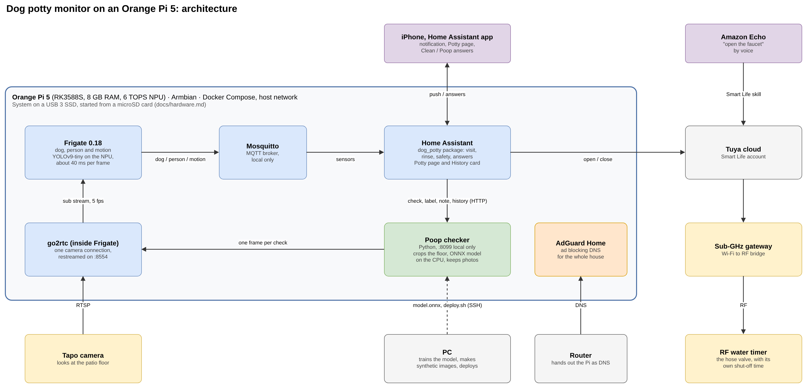

# Architecture



## Containers

All five run from `stack/docker-compose.yml` with `network_mode: host`.

| Container | Image | Job |
| --- | --- | --- |
| `frigate` | `ghcr.io/blakeblackshear/frigate:stable-rk` | Reads the camera through its built-in go2rtc, detects dog and person on the NPU, publishes counts and motion over MQTT |
| `mosquitto` | `eclipse-mosquitto:2` | MQTT broker, on 127.0.0.1 only, no passwords |
| `homeassistant` | `ghcr.io/home-assistant/home-assistant:stable` | Runs the potty flow (`packages/dog_potty.yaml`), talks to the hose through Tuya, notifies the phone, serves the Potty page |
| `poop-checker` | built from `stack/poop-checker` | Takes the check photo, crops it, runs the classifier, files labels, keeps the history |
| `adguardhome` | `adguard/adguardhome:latest` | DNS with ad blocking for the house |
| `one-kvm` | `silentwind0/one-kvm` | Optional IP KVM, only with `docker compose --profile kvm up -d`. Not set up |

## Ports

| Port | Service | Reachable from |
| --- | --- | --- |
| 8123 | Home Assistant | Home network |
| 8971 | Frigate web UI, with login | Home network |
| 1984, 8554 | go2rtc API and RTSP restream, no password | Home network |
| 53, 80 | AdGuard Home DNS and admin UI | Home network |
| 5000 | Frigate API, no login | The Pi only |
| 1883 | MQTT | The Pi only |
| 8099 | Poop checker | The Pi only |

Nothing is forwarded from the router.

## Frigate to Home Assistant

Home Assistant reads Frigate straight from MQTT, so the Frigate integration from HACS is not
needed. `dog_potty.yaml` defines three binary sensors:

| Entity | Topic | On when |
| --- | --- | --- |
| `binary_sensor.potty_cam_dog_occupancy` | `frigate/potty_cam/dog` | count > 0 |
| `binary_sensor.potty_cam_person_occupancy` | `frigate/potty_cam/person` | count > 0 |
| `binary_sensor.potty_cam_motion` | `frigate/potty_cam/motion` | `ON`; Frigate sends `OFF` 20 s after the last movement |

All three follow `frigate/available`, so they read `unavailable` when Frigate is down. Frigate
does not keep these topics on the broker, so after a Home Assistant restart they read
`unknown` until something happens. The flow counts `unknown` as clear and `unavailable` as
not clear.

Frigate's motion settings matter here: `contour_area: 25` ignores insects and leaves, and a
mask hides the camera's clock. There is no zone: the dog can use any part of the floor.

## Poop checker API

A small Python HTTP server (`stack/poop-checker/app.py`, standard library plus OpenCV and
ONNX Runtime) on `127.0.0.1:8099`. Home Assistant calls it through `rest_command` and `rest`
sensors.

| Call | Does |
| --- | --- |
| `POST /check` | Grabs one frame from go2rtc, saves the 640x640 floor crop, the full frame and a thumbnail, runs the model if `data/model.onnx` exists, returns `{"id", "poop_prob"}` |
| `POST /label?id=&label=clean\|poop` | Moves the crop and the full frame into `dataset/<label>/` |
| `POST /note?id=&event=` | Records what the hose did for a photo: `rinse_open`, `rinsed`, `rinse_skipped`, `rinse_paused` |
| `POST /delete?id=` | Moves every file of a photo to `data/deleted/<id>/`, so a wrong tap can be undone |
| `POST /preview` | Saves the full frame with the crop box drawn, for aiming `POTTY_CROP` |
| `POST /frame` | Saves a full frame of the empty patio, raw material for synthetic images |
| `GET /history?limit=30` | Newest photos with label, model probability and hose result |
| `GET /health` | Model present, label counts, number of saved frames |

A new `model.onnx` is picked up on the next check, with no restart.

### Files on the Pi

```
poop-checker/data/
  unlabeled/<id>.jpg         crops waiting for an answer
  dataset/clean|poop/        labeled crops: the training set
  full/unlabeled|clean|poop/ the full camera frames, filed the same way
  frames/                    empty-patio frames, one every 30 minutes
  deleted/<id>/              photos deleted from the History tab
  history.jsonl              one line per check and per hose event
  model.onnx                 the classifier, once trained
homeassistant/www/potty/     the crops and thumbnails the Potty page shows
```

The full frames are kept so the labels survive a change of the crop.

## Home Assistant

### Package `dog_potty.yaml`

| Kind | Name | Purpose |
| --- | --- | --- |
| Automation | `potty_visit_start` | Opens a visit on any dog sighting |
| Automation | `potty_visit_end` | Waits for a still, empty patio, runs the check, picks the branch, notifies |
| Automation | `potty_answer` | Turns a notification button into `potty_handle_answer` |
| Automation | `potty_valve_stop_for_visitor` | Closes the hose when the dog or a person walks into a rinse |
| Automation | `potty_valve_safety` | Closes any hose left open for 2 minutes |
| Automation | `potty_collect_frames` | Saves an empty-patio frame every 30 minutes |
| Automation | `potty_alexa_relogin` | Tells the phone when Alexa Media Player needs a new login |
| Script | `potty_rinse` | Pause check, wait for a clear patio, open, wait, close, with history notes |
| Script | `potty_handle_answer` | Files the label; rinses only for the newest photo within the answer window |
| Script | `potty_delete_photo` | Deletes a photo through the checker |
| Script | `potty_valve` | Opens or closes the hose, whether it is a `valve` or a `switch` |
| Script | `potty_notify` | Sends to the phone set in `secrets.yaml` |
| Script | `potty_reset_settings` | Puts the timers back to their defaults |

Helpers: `input_boolean` pauses (checks, hose, frame saving), `input_number` timers (all
editable on the Settings tab), `input_text.potty_last_shot` and `potty_last_answer`, and
`input_datetime.potty_last_check`. The phone's notify action and the Echo entity come from
`secrets.yaml` (see `secrets.example.yaml`).

### Potty page

A YAML dashboard (`dashboards/potty.yaml`) with three tabs:

- **Photo:** the newest check photo, its time and answer, and Clean / Poop buttons. A tap
  on the phone notification opens it. iOS did not load photos inside the notification
  reliably, so the notification carries a link instead of the image.
- **History:** a custom card (`www/potty-history-card.js`, plain JavaScript, no libraries)
  with the last 30 photos, their label, model probability and hose result, and Clean / Poop /
  Delete on each. Tapping a photo opens it full screen with the same buttons and swipe
  between photos.
- **Settings:** status, the three pause switches, all timers, a "Rinse the spot now" button,
  and a description of the project.

Home Assistant serves `/local` files with a 31-day cache, so a change to the card needs a new
`?v=` in `configuration.yaml` and a restart. `deploy.sh` refuses to deploy the card without it.

## The hose

A Tuya RF water timer behind a Sub-GHz gateway, added with Home Assistant's Tuya integration
(Smart Life account) and renamed `valve.potty_valve`. Its own "irrigation duration" is set to
the rinse length, so the valve closes by itself even if Home Assistant or the cloud fail.
Alexa opens it by voice through the Smart Life skill, outside Home Assistant; the safety
close still covers those opens.
