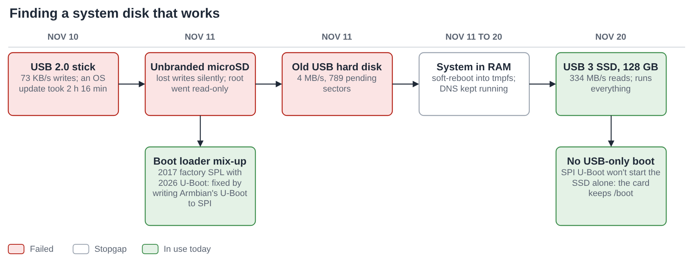

# Hardware: what it needs, and what it took

## What the project needs from a board

| Need | Why | Orange Pi 5 here |
| --- | --- | --- |
| An AI accelerator, not a GPU | Frigate runs an object detector on every frame with motion. On a CPU that is slow and hot; on an NPU or TPU it is cheap | RK3588S NPU, 6 TOPS, 3 cores. About 30 to 50 ms per detection |
| Hardware video decoding | The camera stream is decoded all day | RK3588S video decoder, used by ffmpeg through `preset-rkmpp` |
| 4 GB of RAM at least, 8 GB comfortable | 1.8 GB in use today, plus caches, updates and image builds | 8 GB LPDDR4X, plus 3.9 GB of compressed swap (zram) |
| A real system disk | Docker images alone are 8 GB, and Home Assistant, Frigate and AdGuard write all day | 128 GB USB 3 SSD |
| Wired Ethernet | Camera stream, DNS for the house | Gigabit port |

### RAM and "VRAM"

The project needs no graphics card and no video memory. Nothing here renders graphics, and
the two models are small:

- Frigate's detector, YOLOv9-tiny at 320x320 in FP16, runs on the **NPU**. The NPU has no
  memory of its own: it shares the board's RAM, and the model takes a few MB of it.
- The poop classifier, YOLO11n at 320x320, runs once per visit on the **CPU** with ONNX
  Runtime. A classifier this size takes a fraction of a second on these cores (an estimate:
  no model is trained yet), so it needs no accelerator, and the same model file runs on any
  board.
- The board's Mali GPU is not used.

What does take memory is the software around the models. Measured on 2026-11-23, with
everything running:

| Container | RAM | CPU |
| --- | --- | --- |
| Frigate (detection, go2rtc, ffmpeg) | 825 MB | about 8 % of the board |
| Home Assistant | 380 MB | under 1 % |
| AdGuard Home | 137 MB | under 1 % |
| Poop checker | 123 MB | idle between visits |
| Mosquitto | 7 MB | idle |
| **Whole system** | **1.8 GB of 7.7 GB** | load average 0.3 to 0.5 |

Frigate also gets a RAM disk of up to 1 GB for its cache and 128 MB of shared memory, mostly
unused because recording is off. The board stayed at 32 °C.

So a 4 GB board would run today's stack, with little room for Home Assistant updates,
Frigate building its image cache, or the KVM container. 8 GB leaves plenty.

### Disk

| Item | Size |
| --- | --- |
| Frigate image (`stable-rk`, Rockchip build) | 5.15 GB |
| Home Assistant image | 2.38 GB |
| Poop checker image (Python, OpenCV, ONNX Runtime) | 377 MB |
| AdGuard Home, Mosquitto | 100 MB |
| Armbian, minimal | about 2 GB |
| Empty-patio frames for synthetic images | 25 MB a day |
| **In use today** | **11 GB of 118 GB** |

A 32 GB disk would fit, but an update pulls a new Frigate image next to the old one, so
leave at least 10 GB free. More important than size is that the disk is honest: see below.

### Other boards

Not tested here. These are the parts to match:

- **Raspberry Pi 5 (8 GB):** no NPU of its own. Frigate supports the Hailo-8L of the Raspberry
  Pi AI Kit and AI HAT+, and the Coral USB TPU, as detectors. Without one, Frigate's CPU
  detector works but is slow and keeps the CPU busy. Use an SSD (NVMe through the PCIe slot,
  or USB 3).
- **Other RK3588 boards** (Orange Pi 5 Plus, Rock 5B and similar) use the same Frigate
  `stable-rk` image and `rknn` detector. They need a vendor (Rockchip BSP) kernel for the NPU
  driver.
- **A mini PC with an Intel CPU** can run Frigate's OpenVINO detector on the integrated GPU.

The rest of the stack (Home Assistant, the poop checker, AdGuard) runs on any 64-bit board.

## What we did on the Orange Pi 5

### Software choices that fit the board

- **Armbian with the vendor kernel** (Debian trixie, kernel 6.1.115-vendor-rk35xx). The NPU
  driver (`rknpu` 0.9.8) and the video decoder come with Rockchip's kernel, not mainline.
  Checks: `/dev/dri/renderD128` and `renderD129` exist, and
  `/sys/kernel/debug/rknpu/version` prints the driver.
- **Frigate `stable-rk`** with the `rknn` detector on all 3 NPU cores, the camera's sub stream
  at 5 fps for detection, and ffmpeg's Rockchip decoder.
- **Recording off.** Nothing in the flow reads recordings, and it saves the disk from writing
  video all day. Snapshots of dog and person events are kept 7 days.
- **The poop model on the CPU.** It runs once per visit, so moving it to the NPU (which needs
  an RKNN conversion) would save nothing that matters.
- **Docker set up for a small disk:** one copy of each image instead of compressed plus
  unpacked (`containerd-snapshotter` off), and logs capped at 3 x 10 MB per container.
  `tools/host/install-docker.sh` writes that before Docker's first start.
- **Local-only services.** Frigate's API, MQTT and the poop checker listen on 127.0.0.1, so
  they need no passwords. Every container uses the host network.

### Finding a system disk that works

Most of the hardware time went into storage, not into the AI:

1. **USB 2.0 stick, 16 GB.** The board's ROM cannot start from USB, but the factory loader in
   its SPI flash can. It worked, at 73 KB/s of writes: the first OS update took 2 h 16 min and
   logins took minutes. A stick like this cannot carry Docker.
2. **Unbranded microSD cards, taken out of a camera.** The first one passed write tests, then
   returned stale data without any I/O error: damaged Python files inside Home Assistant,
   then a directory checksum error that turned the root filesystem read-only.
   `tools/host/integrity-check.sh` was written then: it re-hashes every Docker layer, checks
   every Debian package file, and test-loads every Python bytecode file. The second card of
   the same model failed on its first erase.
3. **Boot loader mix-up, found on the way.** With an Armbian card in the slot, the board's 2017
   factory loader in SPI started the 2026 U-Boot from the card, which left a blank screen, and
   warm restarts crashed the kernel. A read-only copy of the SPI flash showed why (its boot
   order tries the card first). Fix: Armbian's own U-Boot written to the SPI flash, after a
   full backup of the factory content. Starts and restarts from the card have worked since.
4. **System in RAM.** To save the configuration from the failing card, the running system was
   copied into a RAM disk and the Pi switched into it with `systemctl soft-reboot`, without a
   restart. Ad blocking for the house kept running from RAM for almost 9 days.
5. **An old USB hard disk** wrote at 4 MB/s and had 789 pending sectors. Abandoned.
6. **A 128 GB USB 3 SSD** (334 MB/s reads). The system was copied onto it from RAM. But
   Armbian's SPI U-Boot did not start from the SSD alone, on either USB port. What works: the
   microSD card stays in the slot and serves only `/boot` (U-Boot, kernel, initrd); the root
   filesystem is on the SSD (`tools/host/card-boot-ssd-root.sh`). The card is only read at
   start-up, which suits a card that loses recent writes. The kernel packages are held, so
   an update cannot put a new kernel on the SSD while the card keeps starting the old one.

Lessons:

- Use a known-good SSD or a brand-name A2 microSD from the start.
- Keep a full copy of the SPI flash before writing it. MaskROM mode (`rkdeveloptool`) can
  always rewrite it.
- When a disk lies, `dmesg` stays quiet. Check the data itself.

### Network

In the first days the Ethernet link dropped in bursts at 1 Gbit and then held at 100 Mbit,
which pointed at the cable or the router port. On the current setup it has held 1 Gbit for
days. Either speed is plenty for one camera and DNS.

The Pi needs a fixed address: a DHCP reservation in the router, and a fixed MAC address in
systemd-networkd, because this board's kernel makes up a new MAC at every start. The router
then hands out the Pi as the house's DNS server, with a public resolver as the second server
while the Pi proves itself.
