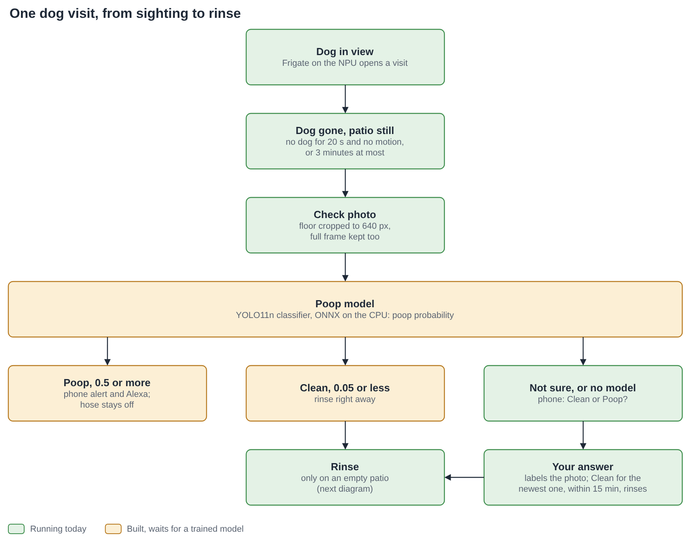
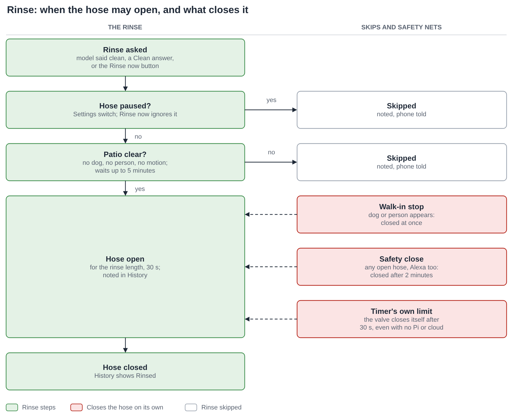
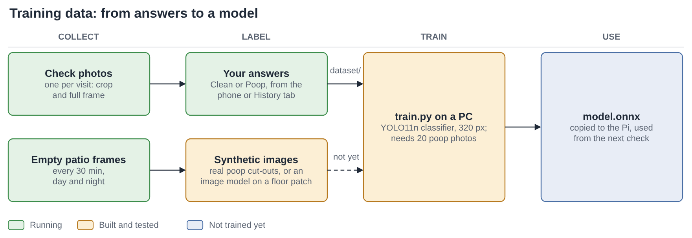

# Pipelines

## One visit

| Step | Rule | Why |
| --- | --- | --- |
| Visit starts | Any dog sighting, anywhere in view, at a score of 0.55 or more | Frigate tracks a moving dog in pieces of 3 to 4 s, so a minimum time missed the first real visit |
| Photo waits | No dog for 20 s **and** Frigate's motion off | Twice the photo caught the dog still standing there, close to the lens, where Frigate had lost it. A moving dog keeps motion on |
| Photo anyway | 3 minutes after the last dog sighting | Rain or insects at the night lights must not hold the check back forever |
| Poop | Model says 0.5 or more | Phone alert, Alexa if installed. The hose stays off |
| Clean | Model says 0.05 or less | Rinse. The threshold is low on purpose: a wrong rinse sprays poop, a wrong question costs a glance at the phone |
| Not sure | Anything between, or no model | The phone asks. The answer labels the photo |
| Answer | Clean on the newest photo, unanswered, within 15 minutes | Rinses. Any other answer only files the label |

The phone notification has two long-press buttons (Clean - rinse, Poop), and a tap opens the
Potty page with the photo. The same answers are on the Photo and History tabs.

## The rinse

Five things keep the hose from doing harm. Each works on its own:

1. **Pause switch.** Notifications and the model only file labels. "Rinse the spot now" on the
   Settings tab still works.
2. **Clear patio.** No dog, no person, no motion. The rinse waits up to 5 minutes, then gives
   up and tells the phone.
3. **Walk-in stop.** The dog or a person appearing during a rinse closes the hose at once.
   It only applies to Home Assistant's own rinse: someone opening the hose with Alexa is
   standing on the patio, and an earlier version closed every manual open within seconds.
4. **Safety close.** Home Assistant closes any hose open for 2 minutes, whoever opened it.
5. **The timer's own limit.** The valve closes itself after its irrigation duration (30 s),
   with no Pi and no cloud.

The Status card on the Settings tab warns when the timer's own limit is shorter than the rinse,
or when the safety close is not longer than it.

### Timers

All are on the Settings tab and survive restarts. "Reset timers" puts back these defaults.

| Setting | Default |
| --- | --- |
| Wait after the dog left | 20 s |
| Photo anyway after | 3 min |
| Rinse answer window | 15 min |
| Wait for a clear patio | 5 min |
| Rinse length | 30 s |
| Close any hose after | 2 min |

## Training data

- **Real photos.** Every answer files the check photo (and its full frame) under
  `dataset/clean` or `dataset/poop` on the Pi. Pee counts as clean, because it should be
  rinsed. Photos with the dog in them are deleted, not labeled.
- **Empty patio frames.** One every 30 minutes when nothing moves and no visit is open, so
  there are backgrounds for every light of the day and night.
- **Synthetic images** (`tools/synth/make_synthetic.py`, on a PC). Poop, or a harmless decoy
  such as a leaf, a puddle or a toy, is added to an empty-patio frame:
  - `paste` uses cut-outs of real poop, scaled by distance and matched in brightness. Free and
    local.
  - `openai` and `gemini` send only a square patch of floor around the chosen spot to an image
    model, then paste back only what changed near the spot. They cost money and need `--yes`.
  - Decoys go through the same steps and are labeled clean, so a model cannot learn
    "edited means poop".
  - Output is YOLO images and box labels, a review page and a manifest. Not yet used for
    training.
- **Training** (`stack/training/train.py`, on a PC or Colab). Fine-tunes YOLO11n-cls at
  320 px, exports `model.onnx`, and prints how the thresholds would behave on held-out
  photos. The poop row's "rinsed" count must be 0. It refuses to train with fewer than 20 poop
  photos.
- **Use.** Copy `model.onnx` to `poop-checker/data/` on the Pi. The next check uses it.
